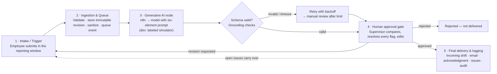

# 7. Five-Step Automation Process Map

| Step | What happens | Component | Output | Failure handling |
|---|---|---|---|---|
| **1. Intake / Trigger** | Employee writes the report (autosave, explicit "none" for empty sections) and submits. The database checks assignment and the window using its own clock. | Vue form → `POST /reports/:id/submit` → `app.submit_report()` | Immutable `report_revisions` row; status **Submitted**; `automation_events` row with idempotency key | Outside window → refused with the reason; supervisor override for late; duplicate submission refused |
| **2. Data ingestion & queue** | API claims the event, loads the revision, removes personal data, detects injection attempts, stores exactly what will be sent, renders the bounded prompt. | `AnalysisPipeline` (`server/src/automation/analysis.ts`) | Status **Processing**; `internal.analysis_inputs` | Dispatch error → event `failed`, retried with exponential backoff |
| **3. Generative AI node** | n8n Workflow A sends the prompt to the model with a strict JSON schema and returns raw output to the API callback. In development, a deterministic simulator stands in and is labeled as such. | n8n (`n8n/workflows/A-…json`) · dev adapter | Raw model output → Zod validation → grounding checks → draft + flags; status **Pending Review**; managers notified | Invalid JSON / schema / `requires_human_review:false` → `invalid_output`, retried; no result in `ai_timeout_minutes` → retried; after `ai_max_attempts` → **manual review** with the original |
| **4. Human approval gate** | Supervisor reviews original vs. draft and source records, decides every flag, edits, links or creates issues, then approves, rejects or requests a revision. | Review workspace → `app.decide_report()` | Immutable `handover_approvals` with approved content and flag decisions | Approval refused while flags are undecided, outside the department, or for one's own report |
| **5. Final delivery & logging** | Approved handover delivered in-app to everyone on the next shift as a **checklist** of problems and tasks; emails queued (link only); outgoing employee notified; incoming workers acknowledge, mark items done with an optional photo, and the supervisor confirms each one; unfinished items persist and escalate; everything audited. | `app.deliver_approval()`, `NotificationDispatcher`, n8n Workflow B, Workflow C / scheduler | Status **Delivered**; `handover_deliveries`, `notification_deliveries` with provider responses, `handover_acknowledgments`, `operational_issues`, `audit_logs` | Email failure → retried, then admin alert; no incoming staff yet → delivered when someone is assigned; stale issues escalated |

## Status flow seen by users

`Draft → Submitted → Processing → Pending Review → Approved → Delivered`,
with `Revision Requested` (back to the employee) and `Rejected` as branches.

## What is live and what is simulated in this repository

| Step | Local demo | Production design |
|---|---|---|
| 1, 2, 4, 5 (database, API, UI) | Real, tested | Same code on Supabase (not yet deployed) |
| 3 AI | Labeled simulator | n8n + model (**not yet verified live**) |
| 5 Email | Dev outbox, recorded as "simulated" | Resend via n8n or direct (**not yet verified live**) |
| 5 SMS | Recorded as "skipped — no provider" | Provider interface only |
